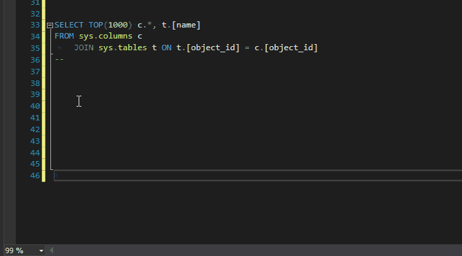
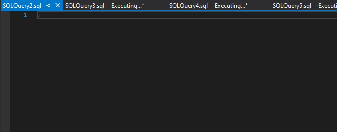
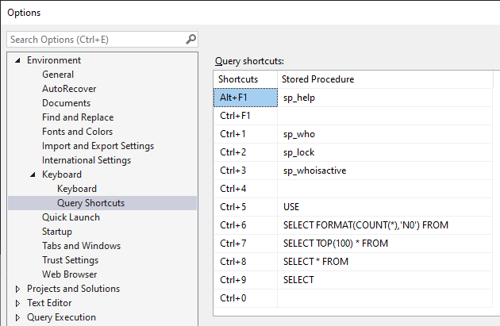

Did you know you could do this in SSMS? Not sure what's happening here? Keep reading...

{:data-gifffer="/img/queryshortcuts/SSMS_1.gif"}

----

**Update (Nov 2026):** If you're on SSMS 22.6 or newer, query shortcuts moved. The feature still works exactly the same, but where you set them and where they're stored has changed. [Skip to the SSMS 22 section](#update-for-ssms-22) if that's you.

----

Everyone has their favorite keyboard shortcuts, snippets, plugins, tools, UI settings, color schemes, etc.

I want to share with you some of my favorite SSMS keyboard query shortcuts that I use to help me speed up my work throughout the day.

SSMS allows you specify a keyboard shortcut using `Ctrl`+`#` using numbers 0-9, as well as `Ctrl`+`F1`. You then assign ANY string you want to that shortcut, and simply use it in any active query window. There's one additional thing to know here...SSMS will also run anything you have **highlighted** along with it. Whatever code you have highlighted gets concatenated onto the end of your query shortcut text and then the whole thing gets executed as a single statement.

If you've ever used `ALT`+`F1` in order to run `sp_help` on a database object, then you should be familiar with this concept, as it's using the same feature.

If that doesn't make any sense...I don't blame you, it's a difficult thing to explain. So I'll show you instead.

**Note:** You must use numbers from the number row. Using `Ctrl`+`# from 10-key` won't work.

----

## Let's do some demos

If you want to know how to set this up, you can [skip to that section](#setting-it-up), but I wanted to show you some demos on how to use it first. The last thing you want to do is accidentally run something you didn't mean to because some dudes blog showed you a new trick.

### The simple use case

Let's say you assign the text: `EXEC sp_whoisactive;` to `Ctrl`+`3`.

Now, every time you press `Ctrl`+`3` it will run `EXEC sp_whoisactive;`.

{:data-gifffer="/img/queryshortcuts/SSMS_2.gif"}

I think that's pretty simple to understand, so we can probably just move on to the more complicated usage...

----

### The more complex use case

Take this string `SELECT TOP(100) * FROM` (make sure there's a space at the end) and let's say that you've assigned it to `Ctrl`+`7`...

Type this query into a query window and only highlight `sys.columns`

```tsql
SELECT TOP(1000) c.*, t.[name]
FROM sys.columns c
    JOIN sys.tables t ON t.[object_id] = c.[object_id]
```

...now hit `Ctrl`+`7`

Here's what happens...you've selected `sys.columns`...now when you hit `Ctrl`+`7`, SSMS takes the string you assigned to the shortcut, concatenates your selection to the end of it, and then runs the whole thing as a single statement.

So `sys.columns` now becomes `SELECT TOP(100) * FROM sys.columns`

Here it is in action:

{:data-gifffer="/img/queryshortcuts/SSMS_1.gif"}

Woah...pretty cool right?

So now instead of copy pasting the table name into some random empty section of the code just so you can check out what the table looks like and then accidentally leave it there and push it to production...That's weird, why is everyone so angry? 🔥🚒

----

### Bonus use case using dynamic SQL

Just discovered this "method" after posting this blog post. It's such an interesting concept that I had to add this section just to throw it out there as I think it opens up a lot of doors to some potentially interesting query shortcuts.

Single word strings do not need to be qualified with quotes when passed into a stored procedure. Now, I **DO NOT** recommend you do this as a general practice...but, it does allow us to come up with some pretty interesting query shortcuts.

Here's an example of this hack just to give you an idea:

```tsql
-- works
EXEC sp_executesql N'SELECT @string',N'@string varchar(100)',ThisIsATest
EXEC sp_executesql N'SELECT @string',N'@string varchar(100)',This_Is_A_Test
EXEC sp_executesql N'SELECT @string',N'@string varchar(100)',[This-Is A Test]

-- doesn't work
EXEC sp_executesql N'SELECT @string',N'@string varchar(100)',This Is A Test
EXEC sp_executesql N'SELECT @string',N'@string varchar(100)',This-Is-A-Test
```

You could set this as one of your query shortcuts. Maybe it looks up info on a table, or a column, or searches stored procedure code. There's all kinds of uses for this. So in this case `ThisIsATest` would be the word you have highlighted. This could be a table, view or stored procedure name, whatever. As long as it is a valid object identifier, or is a single word, then it will be simply passed in as a string.

----

## Setting it up

Setting it up is simple. The option lives under:

Tools > Options > Environment > Keyboard > Query Shortcuts



You'll notice that `Alt`+`F1`, `Ctrl`+`1`, `Ctrl`+`2` are already taken and cannot be changed. I know...it's annoying, but oh well `¯\_(ツ)_/¯`.

Now you can set all the cool query shortcuts you want...well, up to 9.

**Note:** Changing query shortcuts requires a restart of SSMS

**Note:** You'll also see a setting labeled "Execute stored procedure shortcuts without additional execution options". For more info about that, see [this post on Stack Overflow](https://dba.stackexchange.com/questions/162801/what-is-the-ssms-option-execute-stored-procedure-shortcuts-without-additional-e){:target="_blank"}.

----

## My personal query shortcuts

**Note:** to indicate a trailing space, I use `[space]`, if you plan to copy/paste any of these, be sure to replace that with an actual space

| Stored Procedure&nbsp;&nbsp;&nbsp;&nbsp;&nbsp;&nbsp;&nbsp;&nbsp;&nbsp;&nbsp;&nbsp;&nbsp;&nbsp;&nbsp;&nbsp;&nbsp;&nbsp;&nbsp;&nbsp;&nbsp;&nbsp;&nbsp;&nbsp;&nbsp;&nbsp;&nbsp;&nbsp;&nbsp;&nbsp;&nbsp;&nbsp;&nbsp;&nbsp;&nbsp;&nbsp;&nbsp;&nbsp;&nbsp;&nbsp;&nbsp;&nbsp;&nbsp;&nbsp;&nbsp;&nbsp;&nbsp;&nbsp;&nbsp;&nbsp;&nbsp;&nbsp;&nbsp;&nbsp;&nbsp;&nbsp;&nbsp;&nbsp;&nbsp;&nbsp;&nbsp;&nbsp; | Usage/Description                                            |
| ------------------------------------------------------------ | ------------------------------------------------------------ |
| `EXEC sp_whoisactive;`                                       | Run `sp_whoisactive`                                         |
| `USE[space]`                                                 | Highlight a database name and use shortcut to switch to that database |
| `SELECT FORMAT(COUNT(*),'N0') FROM[space]`                   | Highlight a table name, or an entire query from the table name down and use shortcut to get a row count, formatted with commas |
| `SELECT TOP(100) * FROM[space]`                              | Highlight a table name, or an entire query from the table name down and use shortcut to get the top 100 rows back. |
| `SELECT * FROM[space]`                                       | Highlight a table name, or an entire query from the table name down and use shortcut to return all rows and columns. |
| `SELECT[space]`                                              | Highlight a scalar calculation to see its value. Such as `DATEADD(hour, 100, GETDATE())` |

----

## The poor mans snippet manager?

Okay...I *really* shouldn't be showing you this for multiple reasons. For starters...SSMS actually has a [snippet system built into it](https://www.sqlshack.com/sql-snippets-in-sql-server-management-studio/){:target="_blank"} and secondly, this is super hacky. For some reason, I don't remember why, I didn't like the built in SSMS snippet support (though admittedly I've never used it, I've only read about how to use it), and I chose to do this insanity instead. This was long before I learned about [SQL Prompt](https://www.red-gate.com/products/sql-development/sql-prompt/){:target="_blank"} and other SSMS plugins. But it's too ridiculous not to show it...So, why not...

I threw this together as an example. Say you have a handful of queries that you constantly forget the syntax to and you want to quickly load them into SSMS...Well then...why not just build a snippet table into a keyboard shortcut? Because that seems reasonable....right?

```tsql
SELECT y.a, y.b
FROM (SELECT nl = CHAR(13)+CHAR(10)) x
CROSS APPLY (
  VALUES
      (N'offset fetch'      , N'OFFSET 0 ROWS FETCH NEXT 1 ROWS ONLY'),
      (N'case sensitive'    , N'COLLATE SQL_Latin1_General_CP1_CS_AS'),
      (N'percentage'        , N'CONVERT(decimal(6,3), COALESCE($Numerator$ / NULLIF($Denominator$ * 0.01, 0), 0.00))'),
      (N'crlf'              , N'CHAR(13)+CHAR(10)'),
      (N'throw'             , N'; THROW 51000, '''', 1;'),
      (N'select in values'  , N'SELECT x.Col1, x.Col2'+x.nl+'FROM (VALUES (''Val1'',''Val2''), (''Val3'',''Val4'')) x(Col1,Col2)'),
      (N'shrug'             , N'-- ¯\_(ツ)_/¯'),
      (N'rename column'     , N'EXEC sp_rename ''dbo.$Table_Name$.$Column_Name$'', ''$NewColumn_Name$'', ''COLUMN'';'),
      (N'rand val in range' , N'DECLARE @a INT = 1, @b INT = 10;'+x.nl+'SELECT FLOOR(RAND(CHECKSUM(NEWID()))*(@b-@a+1))+@a;')
) y(a,b)
ORDER BY 1
```

You can save this as a keyboard query shortcut...BUT it needs to be formatted as a single line first...but I'm nice, so I'll do it for you here:

```tsql
SELECT y.a, y.b FROM (SELECT nl = CHAR(13)+CHAR(10)) x CROSS APPLY (VALUES (N'offset fetch', N'OFFSET 0 ROWS FETCH NEXT 1 ROWS ONLY'),(N'case sensitive', N'COLLATE SQL_Latin1_General_CP1_CS_AS'),(N'percentage', N'CONVERT(decimal(6,3), COALESCE($Numerator$ / NULLIF($Denominator$ * 0.01, 0), 0.00))'),(N'crlf', N'CHAR(13)+CHAR(10)'),(N'throw', N'; THROW 51000, '''', 1;'),(N'select in values', N'SELECT x.Col1, x.Col2'+x.nl+'FROM (VALUES (''Val1'',''Val2''), (''Val3'',''Val4'')) x(Col1,Col2)'),(N'shrug', N'-- ¯\_(ツ)_/¯'),(N'rename column', N'EXEC sp_rename ''dbo.$Table_Name$.$Column_Name$'', ''$NewColumn_Name$'', ''COLUMN'';'),(N'random val in range', N'DECLARE @a INT = 1, @b INT = 10;'+x.nl+'SELECT FLOOR(RAND(CHECKSUM(NEWID()))*(@b-@a+1))+@a;')) y(a,b) ORDER BY 1
```

(just triple click on it, and it will highlight the whole thing)

I mean, I guess in the grand scheme of things, this isn't horrible. And yes...this does all fit. SSMS has a character limit of 32,768 characters for a keyboard query shortcut. I spent 20 minutes figuring that out for you, you're welcome.

Moving on from this atrocity to show you something maybe slightly more useful...

----

## Applying the query shortcuts via PowerShell

An annoying thing about keyboard query shortcuts is they are not stored in your `.vssettings` file. If you install a fresh copy of SSMS, and import all of your settings from a `.vssettings` file...your keyboard query shortcuts won't get restored.

The shortcuts are actually stored in:

```plaintext
C:\Users\{your user folder}\AppData\Roaming\Microsoft\SQL Server Management Studio\18.0\UserSettings.xml
```

I've put together a PowerShell script that I use to "import" my query shortcuts...

**Warning:** Before running this, make sure you back-up your old file in case this code doesn't work for you, or becomes outdated over time, and messes something up.

```powershell
$ssmsUserSettingsFile = "${env:APPDATA}\Microsoft\SQL Server Management Studio\18.0\UserSettings.xml";
$newXml =  "<Element><Key><int>-1</int></Key><Value><string /></Value></Element>
            <Element><Key><int>3</int></Key><Value><string /></Value></Element>
            <Element><Key><int>4</int></Key><Value><string /></Value></Element>
            <Element><Key><int>5</int></Key><Value><string>USE </string></Value></Element>
            <Element><Key><int>6</int></Key><Value><string>SELECT FORMAT(COUNT(*),'N0') FROM </string></Value></Element>
            <Element><Key><int>7</int></Key><Value><string>SELECT TOP(100) * FROM </string></Value></Element>
            <Element><Key><int>8</int></Key><Value><string>SELECT * FROM </string></Value></Element>
            <Element><Key><int>9</int></Key><Value><string>SELECT </string></Value></Element>
            <Element><Key><int>0</int></Key><Value><string /></Value></Element>"
# Open file
[xml]$xmlDoc = gc $ssmsUserSettingsFile; $QESettings=$xmlDoc.SqlStudio.SSMS.QueryExecution;

# Set Settings
($QESettings.SelectSingleNode("QueryShortcuts")).InnerXml=$newXml;

# Save file, then re-open and save again to make it pretty
$xmlDoc.Save($ssmsUserSettingsFile);
[xml]$xmlDoc = gc $ssmsUserSettingsFile;
$xmlDoc.Save($ssmsUserSettingsFile);
```

You can use this same script to make other settings changes to this file, but that's beyond the scope of this post.

----

## Update for SSMS 22

Well…Microsoft moved things around on us.

Starting with [SSMS 22.6.0](https://learn.microsoft.com/ssms/release-notes-22){:target="_blank"} (released May 12, 2026), the query shortcuts settings were migrated out of the old Tools > Options dialog and into the new "Unified Settings" experience that SSMS inherited from Visual Studio 2026. So if you've been on SSMS 22 for a while and the query shortcuts page suddenly looks different…that's why.

Thanks to mattcargile for pointing this out in the comments!

### Where to set them now

It's still under Tools > Options, it just looks different. The easiest way to find it is to type "query shortcuts" into the search box at the top of the settings page.

### Where they're stored now

They're no longer in `UserSettings.xml`. Unified Settings saves anything you've changed from the defaults into a `settings.json` file, and you can open it straight from the settings page by clicking "Edit user settings as JSON".

On my machine it lives here:

```plaintext
C:\Users\{your user folder}\AppData\Local\Microsoft\SSMS\22.{something}\settings.json
```

Notice it's under `Local` now, not `Roaming`.

Here's what the query shortcuts look like in that file:

```json
/* Visual Studio Settings File */
{
  "environment.keyboard.queryShortcuts.shortcuts": [
    { "key": "-2", "storedProcedure": "sp_help" },
    { "key": "-1", "storedProcedure": "" },
    { "key": "1",  "storedProcedure": "sp_who" },
    { "key": "2",  "storedProcedure": "sp_lock" },
    { "key": "3",  "storedProcedure": "EXEC sp_whoisactive;" },
    ...
  ]
}
```

`-2` is `Alt`+`F1`, `-1` is `Ctrl`+`F1`, and the rest are `Ctrl`+`0` through `Ctrl`+`9`. And yes…it's called `storedProcedure` even though you can put *any* string you want in there, same as before.

A couple things to know about this file:

* That first line is a block comment, which technically isn't valid JSON. PowerShell 7's `ConvertFrom-Json` handles it just fine. Windows PowerShell 5.1 does not…it'll throw an error. So either use PowerShell 7, or skip the first line before you parse it.
* The file only holds settings you've *changed* from the defaults. If you've never touched your query shortcuts, that key might not be in there at all.

### Updated PowerShell script

Same idea as the script above, just pointed at the new file. This one writes out the full list of shortcuts, so it works even if the key doesn't exist in the file yet.

**Warning:** Same as before…back up your `settings.json` before running this. And close SSMS first.

```powershell
# Requires PowerShell 7+
$ssmsSettingsFile = (Get-Item "${env:LOCALAPPDATA}\Microsoft\SSMS\22*\settings.json" | Select-Object -First 1).FullName
$settings = Get-Content $ssmsSettingsFile -Raw | ConvertFrom-Json -AsHashtable

$settings['environment.keyboard.queryShortcuts.shortcuts'] = @(
    [ordered]@{ key = '-2'; storedProcedure = 'sp_help' } # Alt+F1 (can't be changed)
    [ordered]@{ key = '-1'; storedProcedure = '' }        # Ctrl+F1
    [ordered]@{ key = '1';  storedProcedure = 'sp_who' }  # Ctrl+1 (can't be changed)
    [ordered]@{ key = '2';  storedProcedure = 'sp_lock' } # Ctrl+2 (can't be changed)
    [ordered]@{ key = '3';  storedProcedure = '' }
    [ordered]@{ key = '4';  storedProcedure = '' }
    [ordered]@{ key = '5';  storedProcedure = 'USE ' }
    [ordered]@{ key = '6';  storedProcedure = "SELECT FORMAT(COUNT(*),'N0') FROM " }
    [ordered]@{ key = '7';  storedProcedure = 'SELECT TOP(100) * FROM ' }
    [ordered]@{ key = '8';  storedProcedure = 'SELECT * FROM ' }
    [ordered]@{ key = '9';  storedProcedure = 'SELECT ' }
    [ordered]@{ key = '0';  storedProcedure = '' }
)

# ConvertTo-Json drops the header comment, so put it back
$json = "/* Visual Studio Settings File */`n" + ($settings | ConvertTo-Json -Depth 10)
Set-Content -Path $ssmsSettingsFile -Value $json
```

The basic idea here is…read the file in as a hashtable, swap out the whole query shortcuts list, then write it back out with the header comment stuck back on top.

If you have more than one SSMS 22 install side by side, you'll have more than one `22*` folder, so double check which one `Get-Item` grabbed.

If you're still on an older version of SSMS, everything above this section still applies.

----

## Final comments

I'm curious to see what all of you are using for your query shortcuts...are you using them for anything interesting or special? Let me know in the comments.
